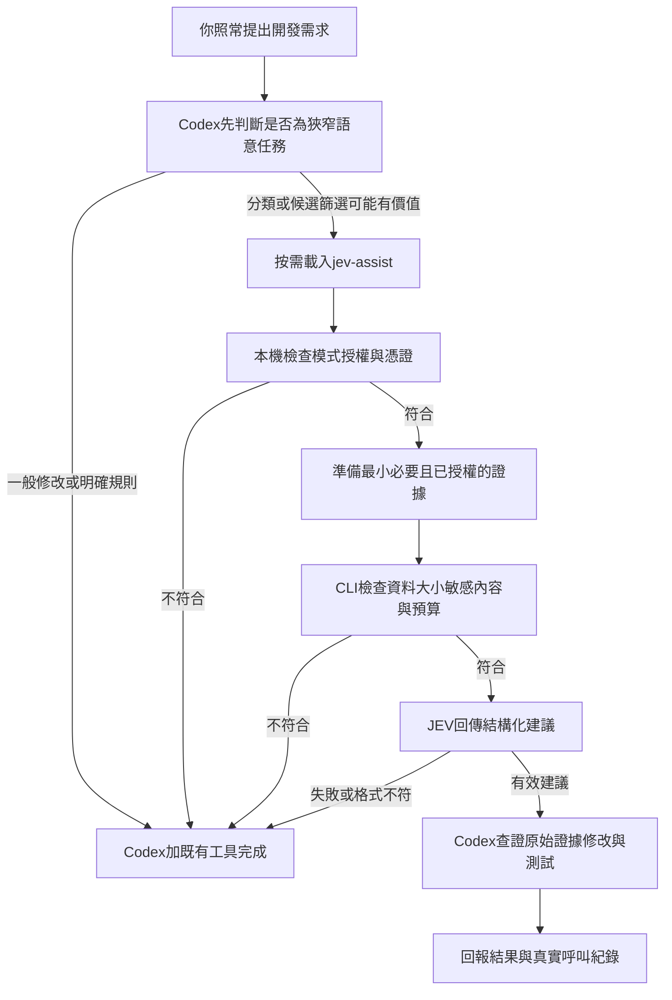

# Codex JEV Router

**讓 Codex 在合適時機使用 JEV 協助分類、篩選與局部檢查；一般工作照常由 Codex 完成。**

這不是另一個大型提示詞，而是一套可安裝、可測試、可停用、可檢查用量的開發輔助工作流。

**狀態：`v0.1.0` 實驗性起始版本。** 已提供可執行 CLI 與離線測試；真實 API、Codex 自動觸發、跨平台 CI 結果及節省比例，必須依各自環境實測。**不保證更省、更快、更準。** 這是獨立社群專案，非 OpenAI 或 TypeSafe 官方產品。

[English overview](README.en.md) · [安裝指南](docs/INSTALL.md) · [工作流設計](docs/ARCHITECTURE.md) · [量測方式](docs/BENCHMARKING.md) · [驗證紀錄](docs/VALIDATION.md)

## 安裝後得到什麼？

| 元件 | 實際用途 |
|---|---|
| 短版全域規則 | 同一個已安裝的 Codex 環境跨專案共用，不必每次重貼 |
| `jev-assist` Skill | Codex 可依任務自行選用，不是每次都呼叫 |
| Python CLI | 真正執行 API 請求、資料檢查、次數限制與格式驗證 |
| Mock 模式 | 不用 API Key 也可測通流程；不呼叫模型、不代表推論 |
| 本機用量紀錄 | 記錄 JEV 實際回報的 token；未知用量不當成零 |
| GitHub Actions CI | 測試這個工作流本身，不替你的產品部署或偷偷開模型 |
| A/B 比較工具 | 匯入你實際量到的 Codex 用量，檢查前後差異；不猜省多少 |

## 工作流程



**Skill 決定「何時考慮使用」，CLI 控制「這次請求是否允許送出」。**
自動選用是 Codex 的行為，不是這個 Python 程式攔截了所有 Codex 請求。

## 先跑一次：不需要帳號或 API Key

Python 3.10 以上。

儲存庫：<https://github.com/john07180718/codex-jev-router>。下載並解壓後，進入含 `README.md` 的專案根目錄；或先執行：

```bash
git clone https://github.com/john07180718/codex-jev-router.git
cd codex-jev-router
```

接著執行：

```bash
python -m jev_workflow demo
python -m unittest discover -s tests -v
```

第一個指令應回傳 `status: MOCK`、`live_attempts: 0`、`authorization_granted: false`。
**MOCK 的數值是測試資料，不代表 JEV 真的做了判斷。**

## 安裝到 Codex：先預覽，再套用

```bash
python tools/install.py --scope user --global-rule
python tools/install.py --scope user --global-rule --apply
```

安裝器會把 Skill 與執行程式放到 `$HOME/.agents/skills/jev-assist`，並合併一段短規則到實際 `CODEX_HOME` 下生效的全域指令檔。會保留其他內容並建立備份。發現既有同名但非本專案管理的 Skill，或已被修改的安裝內容，會停止而不是覆蓋。

使用者層級的 Skill 與全域指令位置依 OpenAI 官方文件；安裝後請開新的 Codex 工作階段檢查是否載入。Windows、WSL、其他電腦與雲端環境需要各自安裝與驗證，不會自動同步。[來源](docs/SOURCES.md)

只裝到某個專案可改用：

```bash
python tools/install.py --scope project --project "/path/to/project" --apply
```

同環境請優先選一種安裝範圍，避免相同名稱的兩份 Skill 造成混淆。

## 啟用真實 JEV：必須由使用者明確操作

**安裝預設仍是 Mock，沒有真實呼叫。** 必須具備：JEV API 使用資格與有效憑證、允許的網路環境、使用者啟用 Live、此專案資料外傳授權。

```bash
python -m jev_workflow init
python -m jev_workflow authorize --project "/path/to/project" --allow-external-data
python -m jev_workflow configure --mode live
```

把 `TYPESAFE_API_KEY` 安全地提供給啟動 Codex 的程序；不要貼到聊天、Git、Issues、指令字串或設定 JSON。已有安全的秘密管理工具可沿用。也提供真人互動終端用的隱藏輸入啟動器：

```bash
python tools/with_key.py codex
```

這會以隱藏方式讀取 Key，僅透過環境變數傳給該子程序，不寫入檔案。它不是秘密隔離機制；同一使用者權限的其他程序或代理仍可能存取環境。

`doctor` 只做本機檢查，**不等於 Key 正確或 API 已接通**：

```bash
python -m jev_workflow doctor --project "/path/to/project"
```

真實呼叫測試請看 [INSTALL.md](docs/INSTALL.md)。首次用合成資料；JEV 費用與額度由各使用者自己的帳號承擔。本專案不附 Key、不共享維護者額度、不轉售 API。

## 哪些工作適合？

| 比較適合的候選情境 | 不應拿來替代的工作 |
|---|---|
| 多筆測試錯誤的語意分類 | 證明錯誤根因、取代重現測試 |
| 已透過搜尋縮小範圍的候選片段評估 | 不分範圍掃完整個程式庫 |
| 指定 diff 是否偏離一條明確需求 | 整體安全認證、完整 code review |
| Review 意見的語意歸類 | 直接接受並執行所有意見 |

目前支援 TypeSafe 的 `choice`、`score`、`noul` 的**受限子集**：字串 state／instructions，Choice 最多 12 個選項且必須有 `NEEDS_REVIEW`，單次最多 8 題。不是完整 TypeSafe SDK。`confidence` 不等於業務成功率；Noul 不帶同樣的 confidence 欄位。[官方介面與信心值](docs/SOURCES.md)

## 預設限制：這是本專案策略，不是官方服務限制

| 設定 | 預設 |
|---|---|
| 模式 | `mock` |
| 指定模型 | `jev-1.13.0`；升級前自行核對可用性與回歸表現 |
| 每個使用者任務 | 最多 3 次預留真實請求；子代理須共用 task id |
| 每日總量 | 同一本機狀態目錄跨專案合計 30 次，按 UTC 日界 |
| 超時 | 每次工作程序 10 秒；超時不保證供應商未處理或未計費 |
| 自動重試 | 預設 0；明確配置後最多 1，且仍占預算 |
| 請求大小 | 包含附加指令的完整供應商 payload 上限 16,000 UTF-8 bytes |
| 重複請求 | 同任務相同 payload 不重送；不永久儲存原始輸入或答案 |
| 高風險任務 | 跳過 JEV，不授予部署、交易、刪資料等權限 |

程式以 SQLite 交易預留額度，防止**共用同一狀態目錄與 task id 的正常合作程序**超出設定次數。
它不是對抗惡意程式的隔離邊界，不能阻止另開 task、換電腦、刪資料庫、改程式或繞過 CLI 直接呼叫 API。
請求次數與 bytes 上限也**不是嚴格美元帳單上限**。

## 停用、專案拒用與移除

```bash
python -m jev_workflow configure --mode off
python -m jev_workflow revoke --project "/path/to/project"
python tools/install.py --uninstall
python tools/install.py --uninstall --apply
```

某個專案可放 `.jev-workflow.json`：

```json
{"enabled": false}
```

專案設定只能停用或縮小限制，不能授權資料外傳或自行開 Live。移除 Skill 不自動刪本機用量與備份，避免意外清除紀錄；整理方式見 [SECURITY.md](SECURITY.md)。

## 用量與省 Token：分開量，不猜測

```bash
python -m jev_workflow stats
python tools/compare_usage.py examples/benchmark.template.json
```

模板未填入數據時，結果應是沒有完整可比較的組數、節省率 `null`，不是 0% 或虛構成效。

真正可能省的是：把大量候選先在工具端縮小，只讓 Codex 讀必要片段。
如果 Codex 已完整分析，才把同一份內容送給 JEV 再檢查，就可能更花 token 和時間。

本程式不自動讀取 Codex 帳號、訂閱用量、私人對話紀錄或未公開的 session 檔格式。
Codex token 必須從你能驗證的來源匯入；JEV token 由有效 API 回應取得。Token、費用、ChatGPT/Codex 訂閱額度是不同衡量，不互相冒充。[A/B 方法](docs/BENCHMARKING.md)

## 專案結構

```text
codex-jev-router/
├── README.md / README.en.md
├── CODEX_SETUP_PROMPT.md        # 可直接交給 Codex 的安全安裝驗收指令
├── AGENTS.md                   # 維護這個 repo 的規則，不是全域檔
├── skills/
│   ├── global-rule.md
│   └── jev-assist/              # Skill、按需參考資料與啟動器
├── jev_workflow/                # API、驗證、預算、資料檢查、CLI
├── tools/                      # 安裝、移除、真人Key啟動器、A/B比較
├── examples/                   # 全部是合成範例與空白量測模板
├── tests/                      # 離線測試；不需要真實Key
├── docs/                       # 安裝、架構、驗證、量測、發佈與來源
└── .github/                    # CI、Dependabot、Issue／PR模板
```

## GitHub 發佈

本資料夾可建立成新的 GitHub repository。先完成 [發佈檢查表](docs/PUBLISHING.md)，建議先用私人 repo 驗證，再自行決定是否公開。
GitHub CI 只測工作流，不執行真實 JEV/OpenAI 呼叫；不要把你的 Key 塞進一般 PR 工作流程。
未提供自動付費 API CI、自動部署或 GitHub 公開發佈腳本。

## 安全、限制與後續

敏感字串掃描只有常見樣式，**不能保證抓到所有密鑰、個資或商業機密**。重要資料仍須人工判斷與公司授權。沒有 JEV 回覆可以覆寫使用者要求、測試、權限或硬性風控。見 [安全說明](SECURITY.md)、[維護規範](CONTRIBUTING.md)、[Roadmap](docs/ROADMAP.md)。

本版提供 MIT 授權；名稱提及 Codex/JEV 僅為說明整合對象，不表示官方認證。

## 資料來源

官方文件核對日期：2026-09-22。完整連結與適用限制見 [SOURCES.md](docs/SOURCES.md)。
